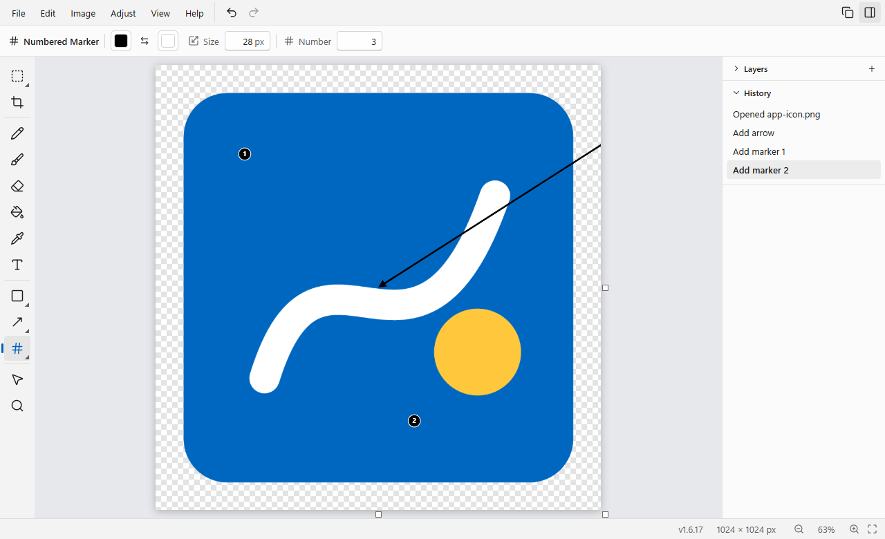

# Sketch

Version 1.5.4. See the [changes](#changes) at the end.

## What It Does

A fast, simple paint app for Windows: as quick to open as Microsoft Paint, with modern tools such as layers, editable shapes, arrows and text, background removal, mark-up for screenshots, whiteboards, tabs and a screen capture key that works anywhere. It's for anyone who wants Paint's speed without its limits, and is built with Tauri 2, TypeScript, Vite and Preact.



## Requirements

- Windows 11, 64-bit. Windows 10 should work (without the Mica background) but is untested. macOS and Linux aren't supported.
- Python 3.9 or newer, for the installer.
- To build Sketch from this folder (the usual install, which builds its own updates):
  - Git
  - Node 24 or newer
  - Rust from rustup, with its MSVC toolchain (the default on Windows)
  - the Visual Studio 2022 C++ build tools
  - the WebView2 runtime (built into Windows 11)
  - about 4 GB of free disk space for the build
- None of the build tools are needed to install the ready-made installer from a release instead (Install, step 2). That copy updates itself by downloading each new release.
- Claude Code is only needed to install it by asking Claude. Sketch itself doesn't use Claude.

## Quick Start

Close Sketch if you have an older copy open, then from the root of the cloned repo (PowerShell):

```powershell
cd apps/sketch
python install.py
```

It checks the build tools, builds Sketch (3 to 10 minutes the first time), installs it and ends with **Setup complete**. Open Sketch from the Start menu.

## Install with Claude Code

Say to Claude Code one of these. Without a clone yet, start with *"Clone https://github.com/masfew/toolbox and"*; with a clone already there, open Claude Code in it.

- *"Install Sketch."* Claude asks whether you want the installer or the dev path, and explains the difference (Claude does, step 2).
- *"Install Sketch using the dev path."* Claude doesn't ask, and always installs the dev path, with `--dev`.

The two installs:

| | Installer | Dev path |
|---|---|---|
| Needs | Python only | Python and the build tools ([Requirements](#requirements)), about 4 GB |
| Installs | The ready-made installer from the latest sketch release | Sketch built from your clone, 3 to 10 minutes the first time |
| Updates | Downloads each new release, within about 5 minutes of it | Builds every commit that changes Sketch's folder on `main`, within about 10 minutes; a push from this PC updates it at once |
| For | Using Sketch | Developing Sketch in this repo. It also turns on the repo's git hooks, which check each push and need gitleaks and the identifier list ([Developer Updates](#developer-updates)) |

Claude follows the repo's install rules: it does the steps under Claude does, and reads out the steps under You do one at a time, waiting for each.

**Claude does:**

1. Checks this is Windows (in PowerShell, `$env:OS` is `Windows_NT`) and that Python 3.9 or newer is installed. On Windows, run `Get-Command python` (PowerShell) first: if it points into `WindowsApps`, `python` may be the Python install manager, whose first run downloads and installs Python, so tell the person and wait for a yes before running `python` at all.
2. Unless you asked for the dev path, asks which install you want, explaining the difference in a few words from the table above, and waits for your answer. It recommends the installer unless you've said you develop Sketch on this PC. "Install Sketch using the dev path" (or "the dev path" in any wording) skips the question.
3. For the dev path, checks the build tools: `git --version`, `node --version` (24 or newer), `rustc -vV` (its `host:` line ends in `msvc`), the C++ build tools and WebView2. `python install.py` checks all five before it builds anything and names any that are missing, so running it is also the check. If `rustc` says rustup has no default toolchain, Rust counts as missing its toolchain: the fix is `rustup default stable-msvc` (a download of about 300 MB).
   If any are missing, asks you once, listing each with its winget command from [Install](#install), step 1, whether to install them, or to switch to the installer, which needs none of the build tools. With your yes it installs them one at a time. If a tool still isn't found afterwards, Claude Code's own PATH is out of date: restart Claude Code and ask again.
   For the installer, it downloads it with `gh release download --repo github.com/masfew/toolbox --pattern "*.exe" <latest sketch-v tag>` when the GitHub CLI is installed, after asking; otherwise you download it (You do, step 1).
4. Tells you the install adds Sketch to the Start menu, makes `.sktch` files open in it, adds **Edit with Sketch** to pictures' right-click menu and lists it in Open with, and waits for your yes.
5. Waits for you to close Sketch if it's open (You do, step 3), then from `apps/sketch` runs `python install.py --dev` for the dev path, or `python install.py --setup <path to the downloaded installer>` for the installer, and checks it ends with **Setup complete**. The first dev-path build takes 3 to 10 minutes. For the dev path it reads out anything `--dev` says is still missing (gitleaks or the identifier list); those only matter for pushing from this PC.

**You do:**

1. Only if a build tool's install shows a Windows admin prompt (the Visual Studio C++ build tools do), approve it. Only if you chose the installer and Claude can't download it: download `Sketch_<version>_x64-setup.exe` from the latest sketch release on the [releases page](https://github.com/masfew/toolbox/releases) and tell Claude where it is. Windows SmartScreen may warn about that installer, since it isn't signed: in the blue window, choose **More info**, then **Run anyway**.
2. Only if a build tool still isn't found after Claude installed it: fully quit and reopen Claude Code, then ask Claude to install Sketch again.
3. Before Claude runs the installer: close every Sketch window, if you have an older Sketch installed.
4. Afterwards, open Sketch from the Start menu and check it starts.

## Install

1. **The build tools.** Install any that are missing, then open a new terminal (PowerShell):

   | Tool | Install with |
   |---|---|
   | Git | `winget install Git.Git` |
   | Node 24 or newer (the current LTS is) | `winget install OpenJS.NodeJS.LTS` |
   | Rust | `winget install Rustlang.Rustup` |
   | Visual Studio 2022 C++ build tools | `winget install Microsoft.VisualStudio.2022.BuildTools --override "--wait --passive --add Microsoft.VisualStudio.Workload.VCTools --includeRecommended"` |
   | WebView2 runtime | `winget install Microsoft.EdgeWebView2Runtime` |

2. **Or skip building:** download `Sketch_<version>_x64-setup.exe` from the latest sketch release on the [releases page](https://github.com/masfew/toolbox/releases), and pass it to the installer with `--setup`. Windows SmartScreen may warn about it, since it isn't signed: in the blue window, choose **More info**, then **Run anyway**. That warning shows once, for the downloaded installer: installs built from a clone and Sketch's own updates never show it. A copy installed this way updates itself by downloading each new release ([Updates](#updates)).
3. **Close Sketch**, if an older copy is open. The installer stops while it's running.
4. From this folder, run `python install.py` (or `python install.py --setup <path to the installer>`) in PowerShell. It:
   - checks the build tools and names the winget command for any that are missing
   - builds the release app and its installer (`npm ci`, then `npm run tauri build`)
   - when the Claude desktop app runs the install, reruns the install step outside the app's package, so Sketch lands in your real AppData folder. It says so when it does.
   - runs Sketch's installer silently. It installs for your user only (no admin prompt) in `%LOCALAPPDATA%\Sketch`, with a Start menu entry. A local build carries no download mark, so SmartScreen doesn't stop it.
   - puts the tool at `~/.claude/tools/sketch` (a link to this folder in a git clone, a copy otherwise), so `--remove` also works from there
   - saves what it installed to `~/.claude/tools/sketch.install.json`
   - with `--dev`, turns on the repo's git hooks, so each push from this PC updates its Sketch at once ([Developer Updates](#developer-updates)). Without it, a clone with no git hooks of its own gets one line naming `--dev`.
5. Open Sketch from the Start menu.

The install is safe to rerun: it builds this folder's current version and installs it over the one there, keeping your settings and autosaves.

Sketch's installer adds it to Explorer without taking over anything:

- `.sktch` files open in Sketch.
- PNG, JPEG, WebP, BMP and GIF files get **Edit with Sketch** in their right-click menu (under Show more options on Windows 11) and Sketch in **Open with**. Sketch is also listed in Settings > Apps > Default apps, if you want it to open them by default.
- Pictures you open or save show in Sketch's jump list (right-click its taskbar button).

Uninstalling removes all of this.

## Configuration

There's no config file. Everything is set inside Sketch: Settings (Ctrl+,) holds the colour theme, keyboard shortcuts (including the capture key), where files opened from Explorer go, the pointer over the picture, whether rough shapes clean up, what happens after a capture, the paste key, and whether Sketch updates while it's closed. Settings, autosaves and update builds live in `%LOCALAPPDATA%\app.sketch.desktop`, which uninstalling removes unless you choose to keep it ([Uninstall](#uninstall)).

| Setting | What it does | Default | Example |
|---|---|---|---|
| Colour theme | Light or dark, or the same as Windows | Same as Windows | Dark |
| Capture Screen (keyboard shortcuts, File) | The key that captures the screen anywhere in Windows, with Sketch open or closed | Alt+Shift+S on a new install (none if another app holds it); an install from before 1.5.0 keeps what it had | Print Screen |
| After a capture | Copy it and show a notification, or open it in Sketch straight away | Notification | Open in Sketch |
| Press Left Shift to open the capture | A Left Shift tap within a second of a capture opens it | On | Off |
| Hide Sketch when capturing | Sketch hides itself before the screen freezes | Off | On |
| Open files from Explorer in | A new tab, or the tab showing | A new tab | The tab showing |
| Pointer over the picture | The pointer shown over the picture with a drawing tool: Windows' normal arrow, a small dot, a thin crosshair or the brush-size circle | Normal arrow | Thin crosshair |
| Dot size, Crosshair size | The dot's width (2 to 32 px) and the crosshair's length (7 to 65 px) | 6 px, 15 px | 21 px |
| Dot and crosshair colour | Automatic (light with a dark edge, so it shows on any picture) or a colour you pick | Automatic | Red |
| Different pointer for the eraser | Gives the eraser a pointer of its own, chosen from the same four | Off | On, with the size circle |
| Clean up rough shapes | Holding the pointer still at the end of a brush or pencil stroke turns a rough line, arrow, box or circle into a clean shape (also **Turn Shape Clean-Up On/Off** in the command palette) | On | Off |
| Open Sketch with the clipboard picture pasted | A key that works anywhere in Windows, even with Sketch closed (it makes a **Paste into Sketch** Start menu shortcut) | None | Ctrl+Alt+V |
| Update in the background when Sketch is closed | The capture helper keeps Sketch up to date while no Sketch window is open ([Updates](#updates)). An open Sketch updates itself either way | On | Off |

## Usage

### Tabs, Autosave and Windows

A window holds several pictures as tabs. New (Ctrl+N), New Whiteboard, Open, a picture dropped beside the canvas, a capture and a file opened from Explorer each open in a new tab, after the one showing; an untouched new picture is used instead when that's what's showing. The tab strip sits under the menu bar once two or more pictures are open: each tab has the picture's name, a dot while it has unsaved changes (it turns into the close button under the pointer), and a close button. Click a tab to show it, or press Ctrl+Tab and Ctrl+Shift+Tab (or Ctrl+PageDown and Ctrl+PageUp). Ctrl+F4, File > Close Tab, the × or a middle-click closes one; Ctrl+W stays Resize, as in Paint. Drag a tab along the strip to move it, or out of the window to open it in a window of its own (its undo history stays behind). Each tab keeps its own undo history, zoom and position.

While moving a selection or picked shapes, rest the pointer on another tab for half a second: Sketch switches to it and brings them along under the pointer. Shapes stay editable; pixels arrive as a floating selection to place. Each picture gets one undo step for it.

Every open picture is autosaved a few seconds after each change, and comes back after a crash or a restart, with each window's tabs back together in their order. Closing a tab or a window with unsaved changes asks Save or Don't Save, once for each picture that has them; clicking outside the box (or Esc) cancels. A capture opened by clicking its notification is the exception: it closes at once and its changes are thrown away, until it's saved to a file.

Only one Sketch runs at a time. Opening a file from Explorer while it's open opens it in a new tab of the window you used last, or in place of the picture showing (after asking about changes) if you pick "The tab showing" in Settings (Ctrl+,). The paste key and captures always get a tab of their own. Settings can also give Sketch a key that works anywhere in Windows, even when Sketch is closed, to open it with the clipboard picture pasted (it makes a **Paste into Sketch** shortcut in the Start menu).

### The Window

A tool rail on the left, menus and an options bar across the top, the picture in the middle, and a side panel on the right for layers and history (F6 or the panel button hides it). Slots with a corner triangle hold more tools: right-click, long-press or click the triangle for the flyout, or press the slot's key again to cycle. The options bar shows only the current tool's settings, and each tool remembers its settings between sessions. Sketch always opens with the Brush in black.

The window opens where you last moved or resized one, maximised if it was, after updates too. Each further window opens a step down and right. If that place is no longer on a screen, the window opens centred. Tools and options that later steps build are already in place, greyed out with the step that builds them.

Light and dark follow Windows, or pick Light or Dark under Colour theme at the top of Settings (Ctrl+,). On Windows 11 the window has the Mica background.

Over the picture every tool shows Windows' normal arrow. If you'd rather have a drawing pointer, pick **Pointer over the picture** in Settings > General: a small dot, a thin crosshair (both with a size and a colour, or an automatic colour that shows on any picture) or a circle the size of the brush at the current zoom. A preview beside the choice shows it on a light and a dark patch. The pointer you pick shows over the picture with the Brush, Pencil, Eraser, Fill, Shapes, Lines and Arrows, Text and Mark-Up tools (the circle for the Brush, Pencil and Eraser; a dot where the tool has no size to show), and over the whole canvas of a whiteboard or capture. The Select, Crop and Colour Picker tools keep their own pointers, and the arrow returns over the toolbars, the options bar and beside the picture. **Different pointer for the eraser** gives the eraser its own choice.

### Drawing Tools

- **Brush** (round, marker or highlighter, with smoothing and pen pressure), **Pencil** (hard pixels) and **Eraser** (to transparent or to colour 2). Shift+click draws a straight line from where the last stroke ended.
- **Fill** with a tolerance, "all matching", and sampling the current layer or the whole picture. Fills run in a worker and swap the old colour out of the soft edges of lines, so there's no fringe. **Colour Picker**, also Alt+click with any tool that paints, and the picker button in a colour's popover, which turns the pointer into the pipette with any tool and sets that colour from the next click on the picture (Esc cancels).
- **Rectangle Select**, **Freehand Select** and **Magic Wand**. Moving, resizing (Shift keeps the shape) or turning a selection lifts its pixels and leaves a see-through hole; Enter or clicking outside places it, Esc puts it back, Delete clears it. Pasted pictures get the same handles. **Transparent** leaves colour 2 out, as in Paint.
- **Crop** with handles and ratios (Enter or the Crop button), plus Resize (Ctrl+W), Canvas Size, Trim to Content, and Rotate and Flip in the Image menu (they turn or flip the selection when there is one).
- **Text** stays editable on a text layer: click to type, drag to make a box that wraps, click a text again to change it, drag it to move it. Font, size, bold, italic, alignment, an outline and a background box (both in colour 2).

### Shapes, Lines and Arrows

- **Shapes** (rectangle with rounded corners, ellipse, polygon, star) and **Lines and Arrows** stay editable: they live on an object layer with text. Drag to draw (Shift keeps a shape square or round, Alt draws it from the centre, Shift turns a line in 15° steps). The outline or line is colour 1 and a shape's fill is colour 2; right-drag swaps them. Outline width, fill, solid, dashed or dotted lines, opacity, and an arrowhead (none, open, filled or dot) at either end.
- **Picking**: click a shape or line with the Shapes, Lines or Select tool to pick it, Shift+click to pick more. Drag to move, handles to resize or turn a shape, a line's ends to move them and its middle handle to bend it. The options bar shows the picked shape's settings and changes it. Delete removes it, arrows nudge it, Ctrl+D duplicates, Ctrl+C and Ctrl+V copy and paste shapes, Ctrl+Shift+] and [ bring to front and send to back. An unfilled shape is picked by its outline, so you can draw inside it.
- **Clean up rough shapes**: draw a line, an arrow (a line with a V at its tip, drawn in the same stroke), a box or a circle with the Brush or Pencil, then hold the pointer still, with the button down, for half a second. The stroke turns into a clean, editable shape in the stroke's colour and width, as if you had drawn it with the Shapes or Lines and Arrows tool: it lands on the shape layer above the current layer and is picked, so you can move, resize or restyle it. While the button is still down, moving the pointer resizes the shape (a line's or arrow's end follows the pointer); letting go keeps it. **Shift** held while holding or dragging makes a box a square and an oval a circle (and turns a line or arrow in 15° steps). It's one undo step, and undoing it brings the rough stroke back exactly as drawn. Only a clear fit changes: scribbles, letters, open curves and strokes drawn without stopping stay as drawn, as does anything drawn with the Eraser. Boxes and ovals come out upright. Moving more than a few pixels starts the half second again. Some people hold still on purpose, so **Clean up rough shapes** in Settings > General (or **Turn Shape Clean-Up On/Off** in the command palette) turns it off; it's on by default, for new installs and for people updating.
- **Smart guides** show while moving, resizing and drawing, and snap to other shapes, text and the picture's edges and centre, and to equal gaps. Hold Ctrl to skip them, or turn them off in View > Snap to Shapes. With two or more picked, the options bar has Align and Space Evenly buttons.
- **Turning into pixels**: painting while a shape layer is current paints underneath it, and says so the first time with a button to rasterize the layer. Image > Rasterize Layer, Edit > Rasterize Shapes and Image > Flatten turn shapes into pixels. PNG, JPEG, WebP and BMP flatten when saved; `.sktch` keeps everything editable.

### Layers

The Layers section of the side panel starts closed, so a picture is one layer until you want more. Open it (or press Ctrl+Shift+N for a new layer) to see every layer, top first, with a small picture of each. Click a layer to work on it, double-click its name to rename it, and drag it up or down to move it (Ctrl+] and Ctrl+[ do the same). The eye hides a layer and the lock stops it being changed: pixel tools, selections, adjustments and picking shapes all leave a locked or hidden layer alone and say why. Under the list are the current layer's opacity and buttons for a new layer, moving it, Merge Layer Down (Ctrl+E) and deleting it. A picture always keeps at least one pixel layer. Every change to a layer is a history step. **Paste onto New Layer** in the Edit menu makes each paste a layer of its own (it's off at first); a paste onto a locked or hidden layer gets a new layer either way.

### Mark-Up

The Mark-Up slot holds tools for screenshots. Everything they draw is an object on a layer called Mark-up (or the current object layer), so it can be picked, moved, resized, turned, restyled and deleted afterwards, like a shape.

- **Highlighter**: draw over text; Shift draws straight. Its colours (yellow, green, blue, pink, orange) darken what's under them, so text stays readable.
- **Blur** and **Pixelate**: drag a box over anything to hide. Both are strong enough by default that text under them can't be read or sharpened back. They hide whatever is under them, on every layer below.
- **Numbered Marker**: click to place 1, 2, 3 and so on. Deleting one renumbers the ones after it. Number on the options bar sets the next one.
- **Callout**: press on what to point at and drag to where the bubble goes (or just click), then type. Moving the bubble keeps the point; drag the round handle to move the point. Callouts are text, so the Text tool edits them too.
- **Spotlight**: drag a rectangle or ellipse to keep bright; everything else dims. Several spotlights on a layer share one dimming.

### Adjust

The Adjust menu changes the selection, or the whole current pixel layer when nothing is selected. **Brightness and Contrast** and **Hue and Saturation** open a small dialog beside the picture, which shows the change live as the sliders move (double-click a slider to reset it). **Black and White**, **Invert Colours** (Ctrl+Shift+I) and **Auto Level** (Ctrl+Shift+L) happen at once. Auto Level stretches the picture to full black and white with one stretch for all colours, so greys stay grey.

### Remove Background

**Remove Background** (in the Adjust menu, the command palette, and on the options bar of the select tools) cuts out the person or object in front and makes everything else see-through. It runs a model on your PC, so pictures never leave it. On a layer, the cut-out goes on a new layer above it and the original layer is hidden underneath, so nothing is lost: show the original again in the Layers panel, or undo (one step). With a selection, only the selected pixels are cut out; a pasted or moved selection is cut out before it's placed. Copying or saving as PNG keeps the transparency.

The model works best on photos with one clear subject; on flat drawings and icons it may keep the wrong part. A 1080p picture takes about half a second.

The first time, Sketch offers a one-time download of 193 MB: the U²-Net model (Apache 2.0) and Microsoft's ONNX Runtime (MIT), which runs it. They come from the `sketch-cutout-1` release on the repo's [releases page](https://github.com/masfew/toolbox/releases), Sketch checks each file's fingerprint (SHA-256) before using it, and they're kept in `%LOCALAPPDATA%\app.sketch.desktop\cutout`. Delete that folder to free the space; Sketch offers the download again next time. Uninstalling Sketch removes it too, unless you choose to keep your data.

### Whiteboards

**File > New Whiteboard** (Ctrl+Alt+N) starts an endless board for diagrams and notes instead of a picture. It's white with a light dot grid, and has no edges: pan and draw in any direction and the board grows to hold whatever you draw. Every tool works on it except the ones for a picture's size (Crop, Resize, Canvas Size, Trim to Content), which are hidden; Rotate and Flip turn only a selection. Ctrl+0, or the fit button in the status bar, zooms to fit everything on the board. Fill fills inside closed outlines only, since empty space on a board never ends. Pastes land in the middle of the view, and a picture dropped from Explorer lands where you drop it.

Save a whiteboard as `.sktch` to keep it endless and editable. Saving it as PNG, JPEG, WebP or BMP, or copying it (Ctrl+C with nothing selected, or Ctrl+Shift+C), gives a picture of what's on the board on white, cropped to the drawing plus a small margin. The dot grid is never in it. A selection copies just the selection. Painted pixels can reach 16384 px across in each direction; shapes and text can go anywhere.

### Mouse Speed

The mouse button at the bottom of the tool rail, above the command palette's search button, opens a slider that sets a slower mouse speed (to as little as a quarter of its speed, never faster than normal) for steadier drawing and handwriting. The slower speed applies only while you hold **Left Ctrl** with a Sketch window in focus, whether you're lining the pointer up or drawing; the rest of the time, drawing included, the mouse keeps its own speed. Sketch puts your own speed back the moment you let go of Left Ctrl, another window takes focus, or Sketch minimises or closes. Right Ctrl does nothing. Holding Ctrl while you drag a shape or line also skips snapping, as it always has. While the speed isn't normal the button stays blue, like a selected tool. Reset to Normal in the slider, double-clicking the slider, or Reset Mouse Speed in the command palette sets it back. The setting is remembered between sessions.

Windows has one mouse speed for the whole PC, so Sketch never saves its change to your Windows settings: if Sketch ever crashed with the slower speed in force, signing out or restarting would bring your own speed back, and so does the next start of Sketch.

### Screen Capture

The capture keys (below), File > Capture Screen or the command palette freeze the screen and dims it, with a toolbar at the top of the screen the pointer is on:

- **Area** (picked at first): drag to capture an area. A click without a drag does nothing.
- **Window**: the window under the pointer is highlighted; click to capture it.
- **Full screen**: the screen under the pointer is highlighted; click to capture it.
- **Close** (or Esc, or a right-click) cancels.

F or Enter captures the screen under the pointer in any mode. The toolbar hides while an area you're dragging comes near it, and stays in view in Window and Full screen modes. It's never in the capture either way, since the screen was frozen before it showed. The blue outline sits just outside a dragged area, and just inside a highlighted window or screen, so it never spills onto the next monitor; it's never in the capture either. Sketch stays on screen and can be captured like any other window; turn on **Hide Sketch when capturing** in Settings to have it hide first instead.

The capture goes on the clipboard, and a Windows notification says so, with a small picture of it. Nothing else opens, so you can paste it straight into another app. Clicking the notification opens the capture in Sketch on a canvas its own size with the Brush in red ready, and brings it to the front. Tapping **Left Shift** within a second of the capture does the same, so there's no waiting for the notification or reaching for the mouse; a Shift pressed later, held, or as part of typing works as normal. **Press Left Shift to open the capture** in Settings turns that off.

A capture's edges are open, as in the Snipping Tool: arrows, writing, circles and brush strokes can run past it onto the grey space around it without being cut off. Copying it (Ctrl+Shift+C or the Copy button), or saving it as PNG, JPEG, WebP or BMP, gives the capture with everything drawn round it, see-through past the capture's edges (white in JPEG and BMP); with nothing drawn outside, that's the capture exactly. The status bar shows the capture's own size, and pointer positions count from its top-left corner. A capture has no size handles; Crop starts from the capture itself, and Resize and Canvas Size first make everything drawn round it part of the picture. This is only for captures: other pictures keep their edges, as in Paint.

The notification stays as long as Windows' own notifications (**Dismiss notifications after this amount of time** in Windows Settings, Accessibility, Visual effects; 5 seconds unless you changed it) and isn't kept in the notification centre: a capture not opened by then is one you only wanted on the clipboard, which it stays on. A newer capture replaces the older one's notification. With Sketch closed, a hidden Sketch starts with the capture as the notification shows, so the click shows it within a few hundredths of a second instead of starting Sketch (about a third of a second); it closes with the notification if you don't click. If Windows won't show the notification (notifications turned off for Sketch), the capture opens in Sketch at once instead. **After a capture** in Settings can open every capture in Sketch straight away instead.

The **Copy** button beside the camera copies the whole picture with everything drawn on it, merged into one PNG with its transparency, as Ctrl+Shift+C does, and says Copied for a moment. On a whiteboard it copies what's on the board, as an export would, and on a capture the capture with everything drawn round it. The picture stays editable.

#### Capture Keys

Capture has one shortcut: **Capture Screen** under File in Settings' keyboard shortcuts (Ctrl+,). A new install starts with **Alt+Shift+S**, or with none if another app already uses it; an install from before 1.5.0 keeps whatever it had, including no key. Its keys work anywhere in Windows, with Sketch open or closed. They can be **Print Screen**, Print Screen with Ctrl, Alt or Shift, or two of Ctrl, Alt and Shift with a letter, number or F key (like Alt+Shift+S). Keys another app already uses are refused with a message saying so. Windows 11 uses Print Screen for its own screen capture until you turn off "Use the Print screen key to open screen capture" (Settings > Accessibility > Keyboard); Sketch says so, with a button that opens that page.

A small helper, `sketch-capture.exe` (installed beside Sketch, under 1 MB), holds the keys and shows the same capture overlay and notification as Sketch, without starting Sketch. Pressed while Sketch is in front, the keys go to Sketch, which hides itself first if **Hide Sketch when capturing** is on. The helper also keeps Sketch up to date while it's closed ([Updates](#updates)). Whenever the shortcut is set or **Update in the background when Sketch is closed** is on (the default), the helper starts when you sign in to Windows and keeps running after Sketch closes, so the keys always work, a notification can be clicked any time and updates arrive; it holds about 3 MB of memory of its own while it waits. Removing the shortcut leaves it running for updates; with the shortcut removed and the switch off, the helper stops and comes out of sign-in. **After a capture** in Settings picks between a notification and opening the capture in Sketch. Captures waiting for their notification are kept in the data folder's `captures` folder, and anything there older than a day is deleted.

Until October 2026 the keys lived on a **Capture with Sketch** shortcut in the Start menu. Sketch moves keys from that shortcut to the helper the first time it starts, and deletes the shortcut. Until 22 Oct 2026 Settings also had a separate in-app shortcut for Capture Screen and a **Keep capture ready when Sketch is closed** switch; an in-app shortcut set then becomes the capture shortcut when Sketch starts, and the helper now always stays ready.

### Shortcuts

Every action lives in one command list (`src/app/commandList.ts`) that feeds the menus, the shortcuts, the command palette and the shortcuts sheet. Shortcuts can be changed in Settings (Ctrl+,); `?` shows them all.

| Keys | Action |
|---|---|
| M, C, P, B, E, G, I, T, U, A | Select, Crop, Pencil, Brush, Eraser, Fill, Colour Picker, Text, Shapes, Lines and Arrows |
| Ctrl+D, Ctrl+Shift+], Ctrl+Shift+[ | Duplicate, bring to front, send to back (picked shapes) |
| Ctrl+Shift+N, Ctrl+E, Ctrl+] and Ctrl+[ | New layer, merge layer down, move the current layer up or down |
| Ctrl+Shift+I, Ctrl+Shift+L | Invert colours, auto level |
| Ctrl while dragging | Don't snap to guides |
| Ctrl+K | Command palette: find any action by name |
| ? | Keyboard shortcuts sheet |
| Ctrl+, | Settings (change shortcuts) |
| Ctrl+N, Ctrl+Alt+N, Ctrl+O, Ctrl+S, Ctrl+Shift+S | New, New Whiteboard, Open, Save, Save As |
| Ctrl+Z, Ctrl+Y (or Ctrl+Shift+Z) | Undo, Redo |
| Ctrl+V | Paste (grows the canvas if needed) |
| Ctrl+C, Ctrl+Shift+C | Copy pasted image or picture, copy whole picture (also the Copy button at the right of the menu bar) |
| Ctrl+A, Ctrl+X, Delete | Select all, cut, clear the selection (on a screen capture with nothing selected, Ctrl+X copies the whole capture and closes it) |
| Enter, Esc, arrows (Shift for 10 px) | Place, cancel or nudge a selection or pasted image; Esc lets go of picked shapes, arrows nudge them |
| Ctrl+Shift+X, Ctrl+W | Crop to selection, resize |
| Shift+click | Straight line from the last stroke |
| Alt+click | Pick a colour |
| Ctrl+wheel or pinch, Ctrl+= and Ctrl+- | Zoom |
| Wheel, Space+drag, middle drag | Pan |
| Ctrl+0, Ctrl+1 | Fit to window, 100% |
| Ctrl+' | Pixel grid on or off (shows from 800%) |
| [ and ], Alt + right-drag | Tool size |
| X | Swap colours |
| F6 | Side panel |
| Alt + menu letter | Open a menu (Alt+F for File) |

## How It Works

The install folder, `%LOCALAPPDATA%\Sketch`, holds a small launcher as `sketch.exe`, `current.json` naming the version to open, and one `app-<commit>` folder per version (the current one and the one before it are kept). The Start menu, taskbar pins, Explorer's "Edit with Sketch" and the capture helper's sign-in entry all go through the launcher. If the newest version can't open, the launcher opens the one before and Sketch says so. The capture helper, `sketch-capture.exe`, runs from the version folder whenever a capture key is set or background updates are on, with a sign-in entry under `HKCU\Software\Microsoft\Windows\CurrentVersion\Run`; the installer starts it after each install.

Settings, autosaves, waiting captures, update builds, the Remove Background add-on and WebView2's profile (the web view's own storage) live in `%LOCALAPPDATA%\app.sketch.desktop`, apart from the install folder, so an update never touches them. Uninstalling removes that folder unless you keep it: the uninstaller's confirm page has a **Keep my settings, autosaves and Remove Background add-on** box, unticked, and a silent uninstall keeps it only with `/KEEPDATA` (`install.py --remove --keep-data` passes it). An update build's folder is a git worktree of your clone, so the uninstaller also prunes the clone's record of it (`git worktree prune`). When Tauri's installer is run over an installed Sketch and removes it first ("Uninstall before installing"), it runs the uninstaller in place, and the uninstaller keeps the data folder then, since Sketch is being installed again. The uninstaller only ever removes the default data folder, never one set with `SKETCH_DATA_DIR` or `--data-dir`.

`install.py` changes nothing else. It builds in this folder (`node_modules`, `dist` and `src-tauri\target`, all ignored by git), runs Sketch's own NSIS installer, and puts this tool at `~/.claude/tools/sketch` with a record of the install in `~/.claude/tools/sketch.install.json`, so `--remove` works from there even if this folder is gone.

### Updates

A Sketch built from a git clone updates itself from that clone, silently, the way Discord and Slack do. The build stamps in which repo and which folder in it Sketch came from, so this works wherever the clone and Sketch's folder are. While Sketch is open, it checks the clone's `origin/main` at start, every 5 minutes, when its window gets focus and whenever a build starts or finishes (the build tells a running Sketch straight away), for a newer commit that changes Sketch's folder. It also fetches `origin/main` itself, at start and every 10 minutes, so a commit pushed from any machine reaches it within about 10 minutes with no `git pull`. The fetch only moves `origin/main`: your branch, checkout and uncommitted work stay as they are, and a fork's install follows the fork's `origin`. It never asks for a sign-in; a fetch that fails (offline, or a private fork with no saved sign-in) is noted once in the build log and tried again in 10 minutes. While no Sketch window is open, the capture helper does the same fetch and check, so a Sketch closed for days is already up to date the next time it opens. It does this with or without a capture key; turning off **Update in the background when Sketch is closed** in Settings stops it, and Sketch then catches up each time it opens. When Sketch finds a newer commit, it builds it in the background, in a git worktree of its own under `%LOCALAPPDATA%\app.sketch.desktop\build` (never in your clone, so uncommitted work never ships), and the build keeps running if you close Sketch. The finished build goes into a new version folder beside the running one; nothing is installed and the running Sketch isn't touched. The next time Sketch opens, it's the new version, with no wait.

The version number (like v1.0.12) sits at the bottom right of the status bar and at the bottom of Settings; its last part counts the commits that changed Sketch's folder, so it goes up with every update. While a new version is building, a small spinning circle sits just in front of it. Once it's waiting, a small circle with an up arrow sits just in front of the version number, and the Help menu has **Restart to Update**, which keeps every open picture and window, restarts, and brings them back on the new version. A Sketch left open restarts into it by itself once nobody has touched the keyboard or mouse for 5 minutes (or the screen is locked), as long as no Sketch window is in front and nothing is half done (a dialog, typing, a capture waiting for its notification). Its windows come back with their pictures, in the same places, minimised if they were, without taking the focus. A failed build is tried again after the next commit.

Updates of a clone install need the same build tools as the install, on the PATH. The build log is `%LOCALAPPDATA%\app.sketch.desktop\build\build.log`.

A Sketch installed from a release's installer has no clone or build tools, so it downloads its updates instead. At start, every 5 minutes and when its window gets focus (and from the capture helper while no window is open, unless background updates are off), it reads `latest.json` from the repo's `sketch-latest` release, a plain download rather than GitHub's rate-limited API. When that names a newer release, Sketch downloads its version folder (about 4 MB), checks that `latest.json` is signed by the release workflow's key and that the download matches the fingerprint (SHA-512) it gives, and stages it exactly as a build is staged, with the same spinner, update icon, **Restart to Update** and quiet restart. A new version reaches it within about 5 minutes of its release. A release no newer than the running one is never downloaded, and a download that's refused, cut off or fails is deleted and tried again at the next check; failures are noted once in the build log, and Sketch itself shows nothing.

Installing the other kind over an install switches it: `python install.py` from a clone over a release install makes it a clone install, and a release's installer over a clone install makes it a release install. Each start clears what the other kind left in the build folder.

### Code Layout

- `src/engine` document and layers, whiteboards (`board.ts`: growth, content bounds, export area), text objects and callouts, shapes and lines (`shapes.ts`), mark-up (`marks.ts`), adjustments (`adjust.ts`), tile-based undo, history, commands (crop, resize, rotate, flip, rasterize, flatten, layers), flood fill, pixel helpers
- `src/view` viewport maths, renderer, mouse and pen input
- `src/io` file formats, encoder worker, BMP, `.sktch`
- `src/platform` Tauri calls with browser fallbacks
- `src/app` app state, actions, a whiteboard growing with the view kept still (`board.ts`), autosave and recovery (`recovery.ts`), the mouse speed slider (`mouse.ts`), launches and windows (`launch.ts`), updates (`update.ts`), layer actions (`layers.ts`), the Adjust menu (`adjust.ts`), Remove Background (`cutout.ts`), the pointer over the picture (`pointer.ts`, `pointerStyle.ts`), the Clean up rough shapes setting (`cleanUp.ts`, `cleanUpPref.ts`), the command list and key bindings, tool state, colours, saved settings
- `src/tools` the tool list with each tool's options (`registry.ts`), strokes, fill and its worker, selection, the transform box, crop, text, shapes and lines (`shapes.ts`), telling a rough stroke's shape (`recognize.ts`) and turning it into one on a hold (`quickshape.ts`), the mark-up tools (`marks.ts`) and callouts (`callout.ts`), and snapping and lining up (`snap.ts`)
- `src/ui` Preact components: menu bar, tool rail, options bar, colour popover, side panel with the layers panel, dialogs, palette, shortcuts sheet, settings
- `src-tauri` Rust side: file reading and writing, clipboard, URL fetch, start-up probe, windows and launches (`lib.rs`), one running Sketch (`instance.rs`), the mouse speed (`mouse.rs`), Remove Background's add-on download and model (`cutout.rs`), screen capture and its overlay (`capture.rs`), its notification (`note.rs`), the capture helper `sketch-capture.exe` (`helper.rs`, started by `src/bin/sketch-capture.rs`), the launcher (`src/bin/sketch-launcher.rs`) and the install layout (`layout.rs`), autosave slots (`recovery.rs`), updates and the quiet restart (`update.rs`), jump list and the paste and capture keys (`shell.rs`), and the installer's launcher layout, Explorer integration and capture helper (`windows/hooks.nsh`)
- `scripts` the checks, the build stamp (`build-info.mjs`, which also writes the installer's `src-tauri/windows/version.nsh`), the update build (`update-build.mjs`) and developer updates after a push (`dev-update.mjs`, started by the repo's `.github/hooks/pre-push`)

## Development

### Run It

From the `apps/sketch` folder (PowerShell):

```powershell
npm install
npm run tauri dev
```

The drawing code also runs in a plain browser for testing: `npm run dev`, then open http://127.0.0.1:1420. Native features (file dialogs, Explorer file paste, clipboard with transparency, drag and drop of files from Explorer) only work in the Tauri app.

### Build and Check

From the `apps/sketch` folder (PowerShell):

```powershell
npm test                 # unit tests (history, viewport, tiles, BMP encoder, keys, search, colours, tools, fill, selection box, text, shapes, snapping, mark-up, adjustments, whiteboards, the pointer setting, recognising rough shapes and the Clean up setting)
npm run tauri build      # release app and NSIS installer
npm run check:size       # installer must be under 15 MB
npm run check:startup    # median start-up must be under 1 second
npm run check:native     # drives the built app: paste, copy, shapes copy and paste, file dialogs, fill, drag and drop, close prompt, Mica, colour theme, saved settings, the pointer over the picture, Clean up rough shapes, autosave and recovery, tabs, more than one window, Remove Background, mouse speed, screen capture, the capture helper and a new install's capture key, the Copy button
npm run check:speed      # 4K paste under 200 ms, brush at 60 fps on 4K, and timings of mark-up, copy and autosave
npm run check:fuzz       # random edits with undo and redo for 3 minutes (add 60 for the hour-long run)
npm run check:update     # silent updates in a scratch install folder against a throwaway clone: the installer's layout, staging, the ready icon, the quiet restart, Restart to Update, the launcher; then (update-remote-check.mjs) fetching pushed commits, the capture helper's updates with no capture key and its background updates switch, release downloads from a local server, signed with a key made for the check, and the old helper handing over after the first capture of an update
npm run check:uninstall  # what uninstalling does with the data folder, on scratch folders: removed by default with its worktree pruned, kept with the box, /KEEPDATA, an update or a reinstall, files in use
npm run perf             # times every everyday action against its budget and the last full audit; npm run perf -- brush save for just some
```

The full performance audit's process, budgets and results are in [docs/performance-audit.md](docs/performance-audit.md).

CI runs the first four on `windows-latest` when anything in this folder changes (`.github/workflows/sketch.yml` at the repo's root).

The `check:` scripts after `check:startup` run locally only. They open the release app, drive its page through WebView2's debugging port (127.0.0.1 only) and fill the Open and Save dialogs with window messages, so they don't move the mouse. They replace whatever is on the clipboard. The capture checks cover the screens with the capture overlay for a moment and show a magenta test window; they drive the overlay with window messages, not the mouse. They never change your mouse speed (the app changes a stand-in file instead). Each gives the app its own data folder (`SKETCH_DATA_DIR`), so they never touch your autosaves or updates or reach a Sketch you have open. The helpers are in `scripts/native-driver.mjs`. The Remove Background checks download the add-on from `check:native`'s own local server, which serves it from the folder in `SKETCH_TEST_CUTOUT_FILES` (holding `onnxruntime.dll` and `u2net.onnx`) or from your installed Sketch's copy; with neither, they're skipped. `check:update` lays out a scratch install folder of its own and never touches the installed Sketch, its shortcuts or the registry. `check:uninstall` builds a stand-in uninstaller from the uninstall steps in `src-tauri/windows/hooks.nsh` that only removes a scratch data folder, and takes a few seconds. Its quiet restart step waits for 2 seconds with no keyboard or mouse input, so leave the PC alone while it runs.

### Developer Updates

While you work on Sketch, a push can update your installed Sketch straight away, so the next time you open it you're already testing what you just pushed, with no wait for the in-app update. In a clone where the repo's git hooks are on (`git config core.hooksPath .github/hooks`, as the root README's "Before You Push" says), each push of `main` to `origin` hands the commit to `scripts/dev-update.mjs` once the pre-push check has passed. Installing with `python install.py --dev` turns them on and names anything their checks still need (gitleaks and the identifier list). Otherwise turn them on once per clone, from this folder (PowerShell):

```powershell
npm run dev:hooks
```

From then on, each push of `main` to `origin` starts the update in the background: once the push has landed, it builds the newest commit that changes Sketch's folder into a new version folder of the installed Sketch, exactly as the in-app update does (the same build folder, lock and log, so the two never build at once). The push itself doesn't wait, the build keeps going after the terminal closes, and a warm build takes about a minute and a half. A Sketch that's open when it finishes shows its update icon and restarts into it as usual. `npm run dev:update` does the same by hand, without a push, and also retries a build that failed.

Install every PC you develop Sketch on with `--dev`. Then a push from any of them updates that PC at once, and the others pick it up with their next fetch, within about 10 minutes, whether their Sketch is open or closed.

Nothing of this is in the app or its installer; it only runs in a clone with the hooks turned on, and does nothing without an installed Sketch. Its messages go to `%LOCALAPPDATA%\app.sketch.desktop\build\dev-update.log`, beside `build.log`. If the clone already has hooks of its own (`core.hooksPath`), `dev:hooks` leaves them alone; call `.github/hooks/pre-push` from yours instead.

## Updating

Read the [changes](#changes) first for anything that needs you to do something. Each version is also on the repo's [releases page](https://github.com/masfew/toolbox/releases), tagged `sketch-v<version>`, with its notes, a zip of this folder, the installer and the update files. A version is released by itself when a push to `main` raises the version line at the top of this README (with its Changes entry); pushes that don't raise it roll into the next release.

Every install updates itself ([Updates](#updates)): one built from a clone fetches and builds new commits, with no `git pull`, and one from a release's installer downloads each new release, so there's nothing to rerun. To update a clone install by hand instead, or after the build tools change, pull and rerun the install from the root of the cloned repo (PowerShell):

```powershell
git pull
cd apps/sketch
python install.py
```

To stay on a version, check out its tag instead, then rerun the install (PowerShell):

```powershell
git fetch --tags
git checkout sketch-v1.0.0
cd apps/sketch
python install.py
```

This moves the whole clone, so every other tool in it goes back to that point too, and Sketch stops updating itself until you're back on `main` (it only updates from commits on `origin/main`). To return to the latest version, run `git checkout main` and `git pull`, then rerun the install.

A release install can also be moved to a release by hand: download its installer and run `python install.py --setup <path to it>`.

If Sketch's folder moves or is renamed (for example when the repo is reorganised), rerun `python install.py` from the new folder. The new build records the new folder, and its first update makes the build worktree again for it.

## Uninstall

Close Sketch, then from this folder (PowerShell):

```powershell
python install.py --remove
```

If this folder is gone, run the same command from `~/.claude/tools/sketch` instead, or uninstall Sketch from Settings > Apps.

This runs Sketch's own uninstaller silently, which removes the program, its Start menu entry, file types, Explorer menu items, jump list and the capture helper's sign-in entry, and everything Sketch keeps in `%LOCALAPPDATA%\app.sketch.desktop`: your settings, autosaves (including pictures you never saved), waiting captures, update builds and the Remove Background add-on. Then it removes `~/.claude/tools/sketch` and its install record.

**To keep your data** (to install Sketch again later, or to keep unsaved pictures), add `--keep-data`:

```powershell
python install.py --remove --keep-data
```

In Settings > Apps, tick **Keep my settings, autosaves and Remove Background add-on** on the uninstaller's first page; leaving it unticked removes them. A Sketch first installed before 1.2.0 still has its old uninstaller, which always keeps the data folder (updates never replace the uninstaller): `install.py --remove` removes the folder itself then, and rerunning `python install.py` once gives Settings > Apps the new uninstaller.

If a file in the data folder is still in use (Sketch closing), the rest goes, and `install.py --remove` says what was left. The build output in this folder (`node_modules`, `dist`, `src-tauri\target`) also stays; `git clean -fdx` in this folder removes it.

## Troubleshooting

| Problem | Cause | Fix |
|---|---|---|
| `FAILED: Sketch is built from source, and these build tools are missing` | A build tool isn't installed, or the terminal was opened before it was | Install what it names with the winget command it gives, open a new terminal, and rerun. Or install a release's installer with `--setup` |
| `FAILED: Sketch is running` | The installer can't replace a running Sketch | Close every Sketch window and rerun. Unsaved pictures come back from autosave |
| `rustc` says rustup has no default toolchain, or the install says Rust is missing its MSVC toolchain | rustup is installed but no toolchain is chosen | Run `rustup default stable-msvc`, then rerun |
| `cargo` or `rustc` not found during the build | Rust was installed after the terminal opened | Open a new terminal. The installer adds `%USERPROFILE%\.cargo\bin` to the build's PATH by itself |
| `link.exe` not found, or `LNK1181` | The Visual Studio C++ build tools are missing or incomplete | Run the build tools' winget command from [Install](#install), step 1 |
| The update icon never shows after a push | Sketch fetches every 10 minutes; the push brought no commit that changes Sketch's folder, the fetch failed, or the build failed | See `%LOCALAPPDATA%\app.sketch.desktop\build\build.log`. "Couldn't fetch origin/main" means git couldn't reach your clone's `origin` without a sign-in prompt: check `git fetch` works in the clone. A failed build is tried again after the next commit, or run `npm run dev:update` from this folder |
| A Sketch installed from a release doesn't update | It couldn't read or download the latest release (offline, or a release made without the signing key) | See the build log above: "Couldn't read the latest release" or "Couldn't download". It tries again at every check, about every 5 minutes |
| Sketch doesn't start from the Start menu after an install run from the Claude desktop app | The install landed in the app's private copy of AppData | Rerun `python install.py`: it reruns itself outside the app's package. Never run the NSIS installer straight from a Claude session |
| Print Screen can't be set as the capture key | Windows 11 uses Print Screen for its own screen capture | Turn off "Use the Print screen key to open screen capture" in Settings > Accessibility > Keyboard; Sketch's Settings has a button that opens that page |

## License

MIT. See the [LICENSE](https://github.com/masfew/toolbox/blob/main/LICENSE) file at the root of the repo.

## Changes

- 1.5.4: The picker button in the colour popover works now. Click it and the pointer becomes the colour picker over the picture, with any tool; the next click on the picture puts that colour into the colour you're editing (colour 2's popover changes colour 2) and the popover shows it. Esc or the button again cancels. Until now the button used a browser feature the app's window doesn't support, so nothing happened.
- 1.5.3: The mouse speed button no longer shows a yellow notice icon when the speed isn't normal, since the slower speed only applies while you hold Left Ctrl. The button still stays blue.
- 1.5.2: The first capture after Sketch updates itself while closed keeps its notification. Until now it vanished a moment after showing, because the updated Sketch replaced the capture helper that showed it; the old helper now waits for its notification to go before handing over.
- 1.5.1: The capture notification stays as long as Windows' own notifications (5 seconds unless changed in Windows Settings, Accessibility, Visual effects) instead of going after 3 seconds.
- 1.5.0: A closed Sketch now keeps itself up to date whether or not a capture key is set: the capture helper runs at sign-in for updates, and **Update in the background when Sketch is closed** in Settings (on by default, also after updating) turns that off. New installs start with **Alt+Shift+S** as the capture key, unless another app already uses it; installs updating from an older version keep their own capture key, or none.
- 1.4.0: Every install keeps itself up to date with nothing to do. An install built from a clone fetches `origin/main` every 10 minutes and builds new commits with no `git pull`, so a push from any PC reaches it; the capture helper does this while Sketch is closed. An install from a release's installer downloads each new release, signed and checked, within about 5 minutes. `python install.py --dev` turns on the git hooks that update the PC you push from at once. A push that raises this README's version line now releases that version on its own.
- 1.3.0: Settings has a **Pointer over the picture** choice: the normal arrow (still the default), a small dot, a thin crosshair or the brush-size circle, with its own size and colour and an optional different pointer for the eraser. Draw a rough line, arrow, box or circle with the brush or pencil and hold still for half a second to turn it into a clean, editable shape; **Clean up rough shapes** in Settings (on by default) or **Turn Shape Clean-Up On/Off** in the command palette turns it off.
- 1.2.0: Uninstalling removes everything Sketch keeps on the PC by default: settings, autosaves, waiting captures, update builds and the Remove Background add-on. Tick **Keep my settings, autosaves and Remove Background add-on** in the uninstaller, or use `python install.py --remove --keep-data`, to keep them. Updates and reinstalls never touch them.
- 1.1.0: Remove Background cuts out the person or object in front onto a new layer, with a model that runs on the PC. Its first use downloads a 193 MB add-on.
- 1.0.0: First release in the toolbox. Updates follow the clone and folder Sketch was built from, wherever they are; a build worktree left by another clone is made again instead of failing. `install.py` builds and installs it, or installs a release's installer with `--setup`, and releases attach the installer.
