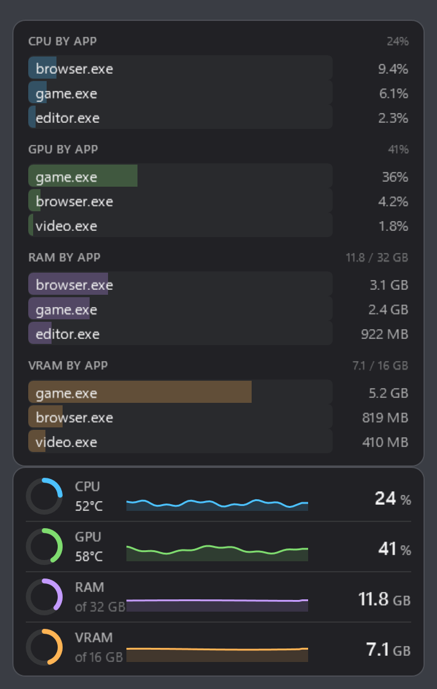
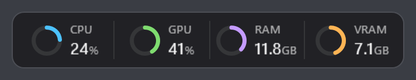

# Vitals

Version 1.1.0. See the [changes](#changes) at the end.

## What It Does

A small always-on-top widget for Windows that shows CPU, GPU, RAM and VRAM use, with the CPU and GPU temperatures, graphs of the last minute and the busiest apps on hover. It's for anyone who wants a glance at their PC's load without keeping a heavy monitoring app (such as NZXT CAM) open, and it costs about 2% of one CPU core while showing.



Collapsed, it's one row of four rings:



(Both pictures use made-up readings, from `Vitals.exe --render <folder> --demo`.)

## Requirements

- Windows 11, 64-bit. Windows 10 should work but is untested. macOS and Linux aren't supported.
- The [.NET 10 SDK](https://dotnet.microsoft.com/download/dotnet/10.0), to build it (`winget install Microsoft.DotNet.SDK.10`).
- Python 3.9 or newer, for the installer.
- An NVIDIA graphics card for the GPU readings (load, temperature and VRAM, read from NVIDIA's driver). With another card, those show a dash; CPU, RAM and the per-app lists still work. Tested with an NVIDIA RTX 40-series card and an Intel CPU; AMD CPUs are untested.
- Optional: the [PawnIO](https://pawnio.eu) driver, for the CPU temperature (see [CPU Temperature](#cpu-temperature)). It needs administrator rights to install.
- Optional: [Claude Code](https://claude.com/claude-code), which Vitals asks once per new CPU or GPU for temperature warning levels that suit that chip (see [Warning Levels](#warning-levels)). Without it, Vitals uses levels worked out from the chip's own limit.

## Quick Start

From the root of the cloned repo (PowerShell):

```powershell
cd apps/vitals
python install.py
```

It checks for the .NET 10 SDK, builds Vitals (about a minute the first time) and opens **Vitals Setup**, an ordinary Windows setup window:

1. **Welcome**, then **Next**.
2. **Choose how Vitals runs**, with two boxes, both ticked to start with:
   - **Start Vitals when I sign in to Windows.** Vitals starts as administrator at sign-in (see [CPU Temperature](#cpu-temperature)), so Windows' administrator prompt shows once, while Setup installs. If you click No there, Start with Windows stays off and Setup carries on.
   - **Let Claude Code pick my temperature warning levels** (see [Warning Levels](#warning-levels)). Setup checks for Claude Code while the page shows. If it can't find it, the box is greyed out and unticked, and says why.
3. **Install.** It shows each step as it goes.
4. **Finish.** **Start Vitals now** is ticked, so Vitals opens when you click Finish. The page also points you at keeping the tray icon on the taskbar and, optionally, at PawnIO for the CPU temperature.

The terminal then ends with **Setup complete**.

## Install with Claude Code

Say to Claude Code: *"Clone https://github.com/masfew/toolbox and install vitals."* With a clone already there, open Claude Code in it and say *"Install vitals."* Claude follows the repo's install rules: it does the steps under Claude does, and reads out the steps under You do one at a time, waiting for each.

**Claude does:**

1. Checks the [requirements](#requirements): that this is Windows (in PowerShell, `$env:OS` is `Windows_NT`), that Python 3.9 or newer is installed, and that `dotnet --list-sdks` lists a 10.x SDK. On Windows, run `Get-Command python` (PowerShell) first: if it points into `WindowsApps`, `python` may be the Python install manager, whose first run downloads and installs Python, so tell the person and wait for a yes before running `python` at all. If the .NET 10 SDK is missing, asks before installing it with `winget install Microsoft.DotNet.SDK.10`. After installing it, Claude Code's own PATH may not see `dotnet` until Claude Code restarts.
2. Tells you that Vitals Setup opens in its own window, that you finish it there (You do, step 1), and that it closes Vitals if it's running and starts it again afterwards. Recommends leaving both boxes ticked.
3. Runs `python install.py` from `apps/vitals` with a timeout of at least 10 minutes, since it waits until you finish Setup. On an update, when you don't want to click through Setup again, it runs `python install.py --quiet` instead, which keeps your current choices and opens no window. Checks it ends with **Setup complete**, and reads out the line that says whether Start with Windows is on.
4. Never installs the PawnIO driver: it's a kernel driver, so that's your call (You do, step 4).

**You do:**

1. Click through Vitals Setup when it opens: **Next**, choose the two boxes, **Install**, then **Finish**. If you left Start with Windows ticked, click Yes on Windows' administrator prompt during the install.
2. If you unticked **Start Vitals now**, open Vitals from the Start menu when you want it.
3. If you want its tray icon on the taskbar rather than in the ^ menu, drag it out, or turn it on under Settings > Personalization > Taskbar > Other system tray icons.
4. Optional: install PawnIO from [pawnio.eu](https://pawnio.eu) for the CPU temperature, then close Vitals from its tray icon and open it again.

## Install

1. Install the .NET 10 SDK if `dotnet --list-sdks` doesn't list a 10.x version: `winget install Microsoft.DotNet.SDK.10` (PowerShell), then open a new terminal.
2. From `apps/vitals`, run `python install.py` (PowerShell). Its options:
   - `--quiet` installs with no window: no questions, and Vitals is running afterwards only if it was before. It keeps your current choices, or on a first install turns both on.
   - `--start-with-windows yes|no` and `--claude-levels yes|no` set Setup's two boxes, or with `--quiet`, the choices themselves.
   - `--test` runs Setup in test mode, for trying it out: it leaves a running Vitals and the Start with Windows task alone, and starts nothing at Finish.

   It:
   - checks for Windows, Python and the .NET 10 SDK, and says how to get anything missing.
   - builds Vitals with `dotnet publish` into `src/Vitals/bin/install`. The first build downloads its one library, [LibreHardwareMonitor](https://github.com/LibreHardwareMonitor/LibreHardwareMonitor), from NuGet.
   - opens Vitals Setup from the build (`Vitals.exe --setup`) and waits for it. Setup asks the two questions above, then:
     - closes a running Vitals, even one running as administrator (it asks Vitals to close through a signal Vitals listens for, and only stops the process if that doesn't work).
     - copies Vitals to `%LOCALAPPDATA%\Programs\Vitals` and adds a Start menu shortcut, `Vitals.lnk`. This needs no administrator rights.
     - for Start with Windows, creates or deletes the scheduled task that starts Vitals at sign-in, which shows Windows' administrator prompt once. When the task is already as you chose, there's no prompt.
     - saves both choices in `%APPDATA%\Vitals\config.json`, keeping your other settings.
     - at **Finish**, starts Vitals if **Start Vitals now** is ticked. A Vitals that was running as administrator comes back as administrator with no prompt.
   - prints what Setup did, and stops with an error if you cancelled Setup or it failed.
   - puts the tool at `~/.claude/tools/vitals`. In a git clone that's a link to this folder (a directory junction, which needs no admin rights); from an unzipped release it's a copy, so `--remove` works from there even after the unzipped folder is deleted. `--copy` or `--link` overrides the choice.
   - saves what it installed to `~/.claude/tools/vitals.install.json`.
   - on Windows, when the Claude desktop app runs the install, reruns its install steps outside the app's package, so they reach the real `%LOCALAPPDATA%`. It says so when it does.
The install is safe to rerun: it builds this folder's current version and opens Setup again, which says it's an update and starts with the boxes as Vitals is set up now. Your settings stay.

## Configuration

The Settings window (the tray icon's menu) holds, with each one's default on a new install:

- **Start with Windows:** as you chose in Setup.
- **At sign-in:** collapsed (or expanded), once Start with Windows is on.
- **Always on top:** on.
- **Lock position:** off, so you can drag the widget and it snaps to screen corners. Turn it on to stop it moving.
- **Snap to screen corners:** on.
- **Background opacity:** 90% (40% to 100%).

Everything else is in `%APPDATA%\Vitals\config.json`, which Vitals creates on first start and reloads as soon as you save it:

| Setting | What it does | Default | Example |
|---|---|---|---|
| `runAsAdmin` | Ask for administrator rights at start when PawnIO is installed (needed for the CPU temperature) | `true` | `false` |
| `updateIntervalMs` | Time between readings, in milliseconds | `1000` | `2000` |
| `graphHistorySeconds` | How far back the graphs go | `60` | `120` |
| `appsListed` | Apps shown in each per-app list | `3` | `5` |
| `askClaudeForWarnings` | Ask Claude Code for warning levels when the CPU or GPU is new | `true` | `false` |
| `warnings.cpu`, `warnings.gpu` | Temperature warning levels: `amber` and `red` in °C. Set `"setBy": "manual"` to keep your own values | set per PC | `{"amber": 85, "red": 95, "setBy": "manual"}` |
| `warnings.vram` | VRAM `amber` and `red`, as a share of the card's memory | `0.85` / `0.95` | `{"amber": 0.9, "red": 0.97}` |
| `expanded`, `position` | Remembered by the widget | | |

`vitals.log` beside it records start-ups, warning-level changes and problems.

## Usage

- **Collapsed:** one row of four rings (CPU, GPU, RAM, VRAM) with their values.
- **Expanded:** click the widget. Each reading gets its own row with a ring, the CPU and GPU temperatures, and a graph of the last minute. Click again to collapse.
- **Hover:** the top apps for CPU, GPU, RAM and VRAM open above the widget, in either view. CPU and GPU show each app's share of the whole chip, as Task Manager does; an app's GPU figure is its busiest engine (3D, copy, video and so on).
- **Drag** the widget anywhere; it snaps to screen corners. By default it sits in the bottom-right corner of the right-most screen.
- **Tray icon:** a left or right click opens its menu: Hide widget (or Show widget), Settings and Close. While hidden, Vitals stops reading the hardware.
- **Warning colours:** a temperature turns amber or red at the levels in `config.json` (see [Warning Levels](#warning-levels)). VRAM turns amber at 85% and red at 95%. In the collapsed view, the CPU or GPU label carries the colour.

Starting Vitals again while it runs shows the widget if it's hidden.

### CPU Temperature

Reading the CPU temperature on Windows needs a kernel driver. Vitals uses LibreHardwareMonitor, which since 2025 uses the **PawnIO** driver instead of the old WinRing0 driver that Windows Defender blocks. Until PawnIO is installed and Vitals runs as administrator, the CPU temperature shows a dash, and Vitals stops trying after three readings.

Once PawnIO is installed, Vitals asks for administrator rights when it starts. If you decline, it runs without the CPU temperature. Without PawnIO it doesn't ask, since administrator rights would add nothing. With Start with Windows on, it starts through Task Scheduler with highest privileges, so there's no prompt at sign-in. Turning Start with Windows on or off shows Windows' administrator prompt once, unless Vitals already runs as administrator.

### Warning Levels

When Vitals starts, it reads the CPU and GPU model names and compares them with the ones saved in `config.json`. On first run, or after a hardware change:

1. It saves fallback levels at once: 10 °C and 3 °C below the chip's own limit (the CPU's TjMax, read from the chip when Intel reports it, else 100 °C for Intel and 95 °C for AMD; the GPU's slowdown temperature from the NVIDIA driver).
2. If Claude Code is installed, it asks it (`claude -p` with Sonnet and web search only, and no settings, hooks or MCP servers) for amber and red levels that fit how that chip normally runs, with a reason for each. This uses a little of your Claude plan, once per new chip.
3. It checks the answer (amber below red, red at or below the limit) and saves it with the model names, the date and the reasons.

If Claude Code isn't installed or doesn't answer, the fallback levels stay and Vitals asks again at its next start. Set `askClaudeForWarnings` to `false` to never ask.

### Command-Line Arguments

| Argument | Use |
|---|---|
| `--startup` | Used by the Start with Windows task: opens collapsed or expanded as Settings says |
| `--no-elevate` | Don't ask for administrator rights |
| `--hidden` | Start in the tray |
| `--render <folder>` | Write PNGs of every view and exit, without showing anything (for checking the look) |
| `--demo` | With `--render`: made-up readings and app names instead of this PC's, for pictures you can share |
| `--panel-open` | Keep the per-app lists open (for measuring their cost) |
| `--make-icon <file>` | Write the app icon (`src/Vitals/vitals.ico`) |
| `--setup` | Vitals Setup, which `install.py` runs from the build. Takes `--quiet`, `--start-with-windows yes\|no`, `--claude-levels yes\|no`, `--setup-log <file>` and `--setup-test` (test mode). Exits with 0 when installed, 1 when it failed, 2 when cancelled |

## How It Works

Vitals is a WPF app (.NET 10) with a WinForms tray icon. It reads:

- CPU load from Windows' performance counters, and the CPU temperature from LibreHardwareMonitor.
- GPU load, temperature and VRAM from NVIDIA's `nvml.dll`, which comes with the NVIDIA driver.
- RAM from Windows.
- CPU, GPU, RAM and VRAM per app from Windows' performance counters, only while the per-app lists are open.

It writes only `%APPDATA%\Vitals\config.json` and `vitals.log`, and, when you turn Start with Windows on, a scheduled task named `Vitals`.

Cost, measured on a desktop Intel Core i9 and NVIDIA RTX 40-series card at one reading a second:

- **Widget showing:** about 2% of one CPU core (0.07% of the whole CPU), almost all of it Windows redrawing the see-through window. Reading the hardware takes under 1 ms.
- **Per-app lists open (hovering):** about 10 ms more per reading. When they open after a pause, the first reading waits 200 ms, since CPU and GPU use per app need two readings.
- **Hidden in the tray:** no measurable CPU.
- **Memory:** about 175 MB while showing, about 110 MB hidden.

The code is in `src/Vitals/`:

- `Sensors.cs`: the readings and the sampling thread.
- `WidgetWindow.cs`: the widget, its views, the per-app panel (a window of its own above the card), dragging and snapping.
- `Tray.cs`: the four-part ring icon, the tray icon and its menu.
- `SettingsWindow.xaml`: the Settings window.
- `WarningLevels.cs`: picking warning levels for new hardware.
- `StartupTask.cs`: the Start with Windows task.
- `Config.cs`: `config.json` and the log.
- `DemoData.cs`: the made-up readings for `--render --demo`.
- `Setup/`: Vitals Setup (`SetupWindow.xaml` for the window, `Installer.cs` for the steps, `SetupRunner.cs` for `--setup`'s options).

To work on it, build with `dotnet build src/Vitals -c Release` and run `src/Vitals/bin/Release/net10.0-windows/Vitals.exe --no-elevate`. [CLAUDE.md](CLAUDE.md) lists the traps.

## Updating

Read the [changes](#changes) first for anything that needs you to do something. Each version is also on the repo's [releases page](https://github.com/masfew/toolbox/releases), tagged `vitals-v<version>`, with its notes and a zip of this folder.

From the root of the cloned repo, pull the new version, then rerun the install (PowerShell). Setup opens as an update; add `--quiet` to skip it and keep your choices. It closes Vitals and starts it again:

```powershell
git pull
cd apps/vitals
python install.py
```

To stay on a version, check out its tag instead, then rerun the install (PowerShell):

```powershell
git fetch --tags
git checkout vitals-v1.0.0
cd apps/vitals
python install.py
```

This moves the whole clone, so every other tool in it goes back to that point too. To return to the latest version, run `git checkout main` and `git pull`, then rerun the install. To keep this tool on one version without moving the others, download its zip from the release instead, unzip it, and run `python install.py` from the `vitals` folder inside it.

## Uninstall

From the tool's folder (PowerShell):

```powershell
python install.py --remove
```

If you installed from a release zip and deleted the unzipped folder, run the same command from `~/.claude/tools/vitals` instead. If you installed from a clone and then deleted it, clone the repo again and run it from `apps/vitals` there.

If Start with Windows is on, it first deletes that scheduled task, which shows Windows' administrator prompt once; if you decline it, nothing is removed. Then it closes Vitals and removes `%LOCALAPPDATA%\Programs\Vitals`, the Start menu shortcut, `~/.claude/tools/vitals` and its install record. It leaves your settings and log in `%APPDATA%\Vitals`, and says so. Delete that folder yourself if you don't need them.

## Troubleshooting

| Problem | Cause | Fix |
|---|---|---|
| The CPU temperature shows a dash | PawnIO isn't installed, or Vitals isn't running as administrator | Install PawnIO from [pawnio.eu](https://pawnio.eu), then close Vitals from its tray icon, open it again, and accept the administrator prompt. |
| The GPU readings show a dash | The card isn't an NVIDIA card, or its driver has no `nvml.dll` | GPU load, temperature and VRAM need an NVIDIA card. The per-app GPU list still works. |
| The tray icon isn't on the taskbar | Windows 11 puts new tray icons in the ^ menu | Drag it out, or turn it on under Settings > Personalization > Taskbar > Other system tray icons. |
| The install says the .NET 10 SDK is needed | It isn't installed, or this terminal started before it was | `winget install Microsoft.DotNet.SDK.10`, then open a new terminal and rerun. |
| Setup says Vitals didn't close | A Vitals that doesn't listen for the install's close signal is running as administrator | Right-click its tray icon, choose Close, and rerun. |
| Setup says Start with Windows stays off, or `--remove` says it couldn't remove the task | Windows' administrator prompt was declined, and creating or deleting that task needs administrator rights | Rerun and click Yes on the prompt, or change Start with Windows in Vitals' Settings, which shows the same prompt. |
| Setup greys out the Claude Code box | It found no `claude.exe` on your PATH or in `%USERPROFILE%\.local\bin`, or `claude --version` didn't answer within 15 seconds. The box says which | Install Claude Code, or open a new terminal if you just did, and rerun. An npm install of Claude Code has no `claude.exe`, so Vitals can't use it. |
| Warning levels stay at the fallback | Claude Code isn't installed or didn't answer | Check `vitals.log` in `%APPDATA%\Vitals`. Vitals asks again at its next start; set your own levels with `"setBy": "manual"`. |

## License

MIT. See the [LICENSE](https://github.com/masfew/toolbox/blob/main/LICENSE) file at the root of the repo. LibreHardwareMonitor, which the build downloads, is under the Mozilla Public License 2.0.

## Changes

- 1.1.0: `install.py` opens **Vitals Setup**, a standard setup window: Welcome, a page with two boxes (start Vitals when you sign in, set up there and then with Windows' administrator prompt; and let Claude Code pick the warning levels, greyed out with the reason when Claude Code isn't found), the install's steps, and a Finish page with **Start Vitals now** and the tray icon and PawnIO tips. `--quiet` installs with no window, and `--start-with-windows` and `--claude-levels` set the two choices. `--remove` now deletes the Start with Windows task itself, with one administrator prompt, instead of asking you to turn it off first. A new install starts with the background at 90% opacity (was 80%). Existing installs keep their own settings.
- 1.0.0: First public version, with `install.py` as its installer and `--render --demo` for pictures with made-up readings.
